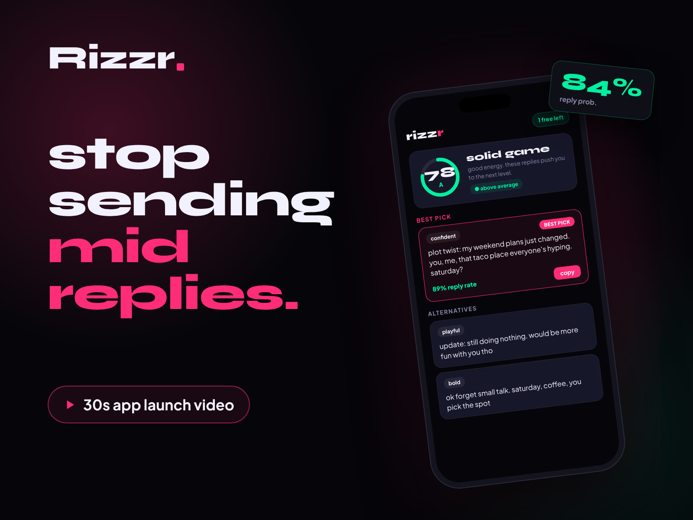
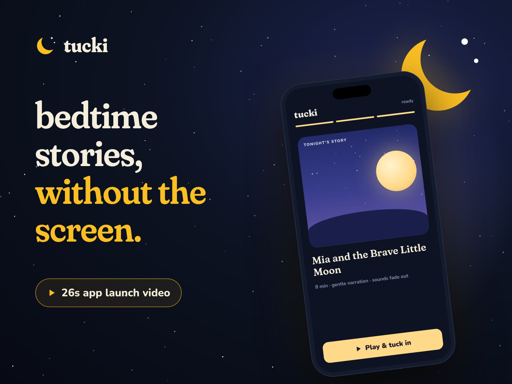

## Juan Cruz Castuera

Developer who makes launch videos. I build motion graphics for SaaS and app launches, animated in code from your real UI, so every frame stays sharp and every revision is a one-line change.

Based in Córdoba, Argentina (UTC−3, full overlap with US business hours). Italian citizen, so EU work authorization comes with me.

---

**Recent launch videos**

  
  

🎬 **Rizzr** · 30s app launch video: chat hook, product walkthrough with the real UI, payoff and logo. 1080p / 60 fps, frame-synced sound design.

🌙 **Tucki** · 26s launch video for a screen-free bedtime story app: calm pacing, soft motion, gentle sound design.

---

**Why a developer?**

Before video I designed, built and shipped products end to end:

- 💬 **Rizzr**: an AI conversation-coaching app I built solo (n8n, Supabase, Vercel), brand and content included. I sunset it after testing showed acquisition costs wouldn't work.
- 🚚 **[Freight Rate Confirmation Extractor](https://github.com/castuerajuanc-dot/freight-rate-confirmation-extractor)**: turns broker PDFs into spreadsheet rows (n8n · Claude API).
- 🛒 **Shopify storefronts**: themes, catalogs, payments.

That background is why my videos show the product the way a user actually feels it: I know what each screen is supposed to do.

---

**Working with**

`Claude` · `HTML / CSS / JS animation` · `React` · `ffmpeg` · `Next.js` · `Vercel`

Open to freelance launch-video and motion-design projects.

[LinkedIn](https://www.linkedin.com/in/castuerajuan) · castuerajuanc@gmail.com
